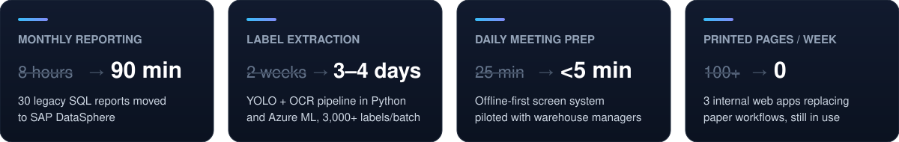
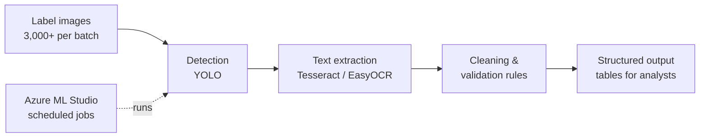
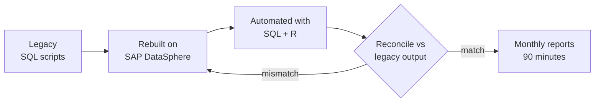

> [!NOTE]
> **👋 Welcome to my new GitHub home.** My older account was mostly university exercises and early experiments, so I started fresh here to keep the work that matters in one place — cleaned up, properly documented, and code I'm happy to walk you through line by line. New projects land here first.

## About me

I'm a **data engineer with a business background** — four years at Salling Group, Denmark's largest retailer, where I went from the warehouse floor to trade planning & pricing and commercial analytics.

My work sits where data engineering meets the business: getting data out of awkward places (legacy SQL, scanned labels, shared folders), turning it into clean, validated tables, and delivering it to the people who make decisions. I hold a BSc in Global Business Engineering (Software Technology) from VIA University College, Denmark.

## 🧱 What I do as a data engineer

| Stage | What I've done |
|---|---|
| **Ingest** | Extracted structured data from 3,000+ product-label images per batch with a YOLO + Tesseract OCR pipeline in Python |
| **Transform** | Rebuilt legacy SQL reporting logic on SAP DataSphere, with SQL and R automation replacing manual steps |
| **Validate** | Reconciled migrated reports against the legacy output before go-live |
| **Orchestrate** | Scheduled, repeatable pipeline jobs in Azure ML Studio; event-driven file processing (Chokidar → WebSocket) |
| **Serve** | Power BI KPI dashboards built with data scientists and business stakeholders; live operational screens on the warehouse floor |

<b>🔍 Label OCR pipeline</b> — two weeks of manual work down to 3–4 days

 

Product labels arrived as images and were typed into spreadsheets by hand. I split the problem into independent stages so each could be tested and improved on its own:

- **Why stages:** a bad crop and a bad OCR read are different problems; separating them made errors easy to trace.
- **Why Azure ML jobs:** batches run the same way every time, without someone babysitting a notebook.
- **Result:** extraction time from ~2 weeks to 3–4 days per batch (~70% less).

📖 **[Full architecture, validation logic and lessons learned →](https://github.com/aleks-al-aleksandrov/label-ocr-pipeline)**

<b>🔁 Reporting migration to SAP DataSphere</b> — 8 hours to 90 minutes

 

Trade planning & pricing relied on legacy SQL scripts run by hand every month. I worked on moving them to SAP DataSphere:

- **What mattered most:** proving the new numbers matched the old ones before anyone relied on them.
- **Result:** the monthly run went from 8 hours to 90 minutes, with outputs reconciled against the legacy reports before go-live.

## 🚀 Projects

### [Smart Gallery System](https://github.com/aleks-al-aleksandrov/smart-gallery-system) — event-driven presentation automation

Warehouse team leaders used to print the day's plans and KPIs every morning. Now they save a file to a folder and every screen on the floor updates about two seconds later — offline, on a Raspberry Pi behind each screen.

`Node.js` `Express` `WebSocket` `Chokidar` `Sharp` `Raspberry Pi` — bachelor project, piloted with warehouse managers: daily meeting prep from 15–25 to under 5 minutes.

### More

| Project | What it is | Stack |
|---|---|---|
| [**label-ocr-pipeline**](https://github.com/aleks-al-aleksandrov/label-ocr-pipeline) | Computer vision + OCR pipeline that turns shelf-label photos into validated product data — 2 weeks to 3–4 days per batch. Architecture, validation logic and tested reference implementations. | Python · OpenCV · YOLO · EasyOCR · Tesseract · Azure ML |
| [**co2-emissions-tracker**](https://github.com/aleks-al-aleksandrov/co2-emissions-tracker-) | Full-stack app for recording CO₂ emissions with statistics, CSV reports and role-based accounts. I led the 3-person team. | .NET 9 · Blazor · ASP.NET Core · EF Core · JWT |
| [**subscription-analytics-dbt**](https://github.com/aleks-al-aleksandrov/subscription-analytics-dbt) | End-to-end subscription analytics pipeline: synthetic data generator → DuckDB → dbt staging, marts, incremental payments (delete+insert + 7-day lookback), SCD Type 2 snapshot, MRR metrics, 84 data tests, and local Airflow orchestration via Astro CLI + GitHub Actions CI. | dbt · DuckDB · SQL · Python · Airflow · GitHub Actions |

## 💼 Experience

| When | Role | Highlights |
|---|---|---|
| 2025 – 2026 | **Student Assistant, Commercial Analytics** · Salling Group | YOLO + OCR pipeline, Azure ML jobs, Power BI KPI dashboards |
| 2025 | **Intern, Trade Planning & Pricing** · Salling Group | Reporting migration to SAP DataSphere, SQL + R automation |
| 2022 – 2025 | **Production Assistant & Internal Systems** · Salling Group | Shift lead for 10+ people; built 3 internal web apps that replaced paper workflows |
| 2021 – 2026 | **BSc Global Business Engineering (Software)** · VIA University College | Bachelor project: Smart Gallery System |

## 💬 What my managers say

> *"Aleks showed initiative in identifying opportunities for process optimization and automation. He proactively sought ways to improve our workflows and implemented solutions that increased our department's efficiency."*
>
> —  Senior Manager, Commercial Analytics, Salling Group

> *"After several months, we noticed that he is interested in daily processes and how to make them better… he is the only responsible person at the production when management is not at work."*
>
> —  Team Leader, Salling Group

## 🛠️ Toolbox

  
   
  

  
  
  
  
  
  
  
   
  <b>Learning now:</b>
  
  
  

## 🧭 How I work

- **Business question first.** Before I touch the data I want to know which decision it will change and what it costs today.
- **Trust is earned with reconciliation.** New numbers get checked against the old ones before anyone relies on them.
- **Measure before and after.** Every result above has a number attached, because "it feels faster" is not a result.
- **Simple things that keep running.** Tools I built for the warehouse were still in daily use more than a year later.

## 📫 Let's talk

Based in **Bulgaria** and open to **Data Engineer**, **Analytics Engineer** and **BI** roles — on-site, hybrid or remote. The fastest way to reach me is [LinkedIn](https://www.linkedin.com/in/aleks-aleksandrov-42a472238/).

🇧🇬 Bulgarian (native) · 🇬🇧 English (fluent) · 🇩🇪 German (basic) · Off the keyboard: hiking, surfing and fishing in the mountains I grew up in.
